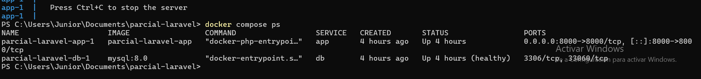
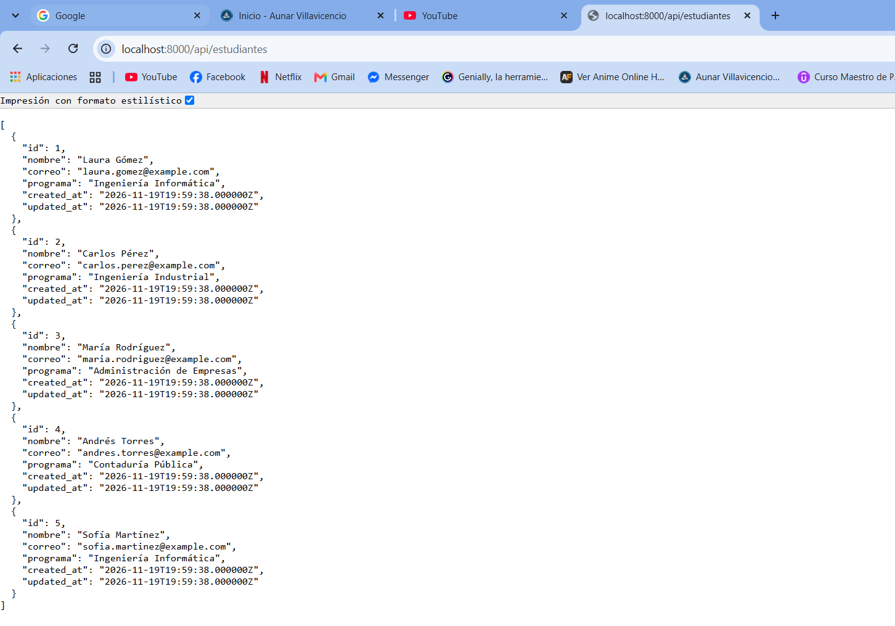
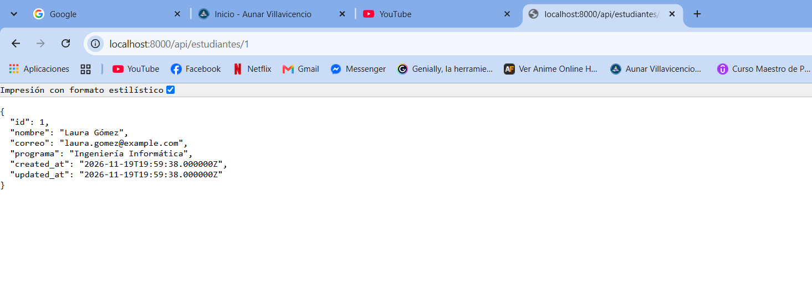
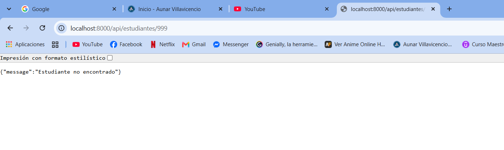
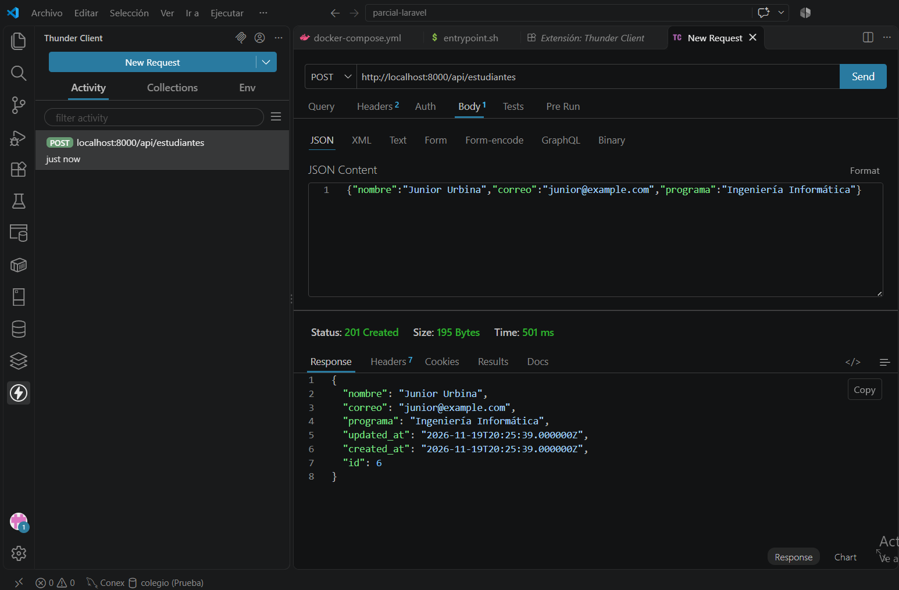

# API de Estudiantes (Laravel + MySQL + Docker)

Parcial 3: API REST en Laravel para registrar estudiantes. La aplicación y la base
de datos MySQL corren en contenedores separados y se levantan con un solo comando.

**Autor:** Yuliana Alexandra Pabon Ortiz

## Requisitos
- Docker Desktop (o Docker Engine + Docker Compose)
- Puerto `8000` libre en la máquina

No hace falta instalar PHP, Composer ni MySQL.

## Pasos de ejecución
1. Clonar el repositorio y entrar a la carpeta:
   ```bash
   git clone https://github.com/TU_USUARIO/TU_REPO.git
   cd TU_REPO
   ```
2. Levantar los servicios:
   ```bash
   docker compose up --build
   ```
   (o con `-d` para dejarlos en segundo plano). La primera vez tarda unos minutos.
   Al iniciar, el contenedor `app` espera a que MySQL esté listo, ejecuta las
   migraciones, carga el seeder con 5 estudiantes y arranca el servidor.
3. Verificar el estado:
   ```bash
   docker compose ps
   ```
4. Probar la API en http://localhost:8000/api/health
5. Detener:
   ```bash
   docker compose down        # conserva los datos
   docker compose down -v     # borra también el volumen de MySQL
   ```

## Estructura de contenedores
| Servicio | Imagen | Función |
|----------|--------|---------|
| `app` | Construida con el `Dockerfile` (PHP 8.4 + Laravel) | API, puerto 8000 |
| `db`  | `mysql:8.0` | Base de datos `parcial`, con volumen `db_data` |

## Endpoints
| Método | Ruta | Descripción | Respuestas |
|--------|------|-------------|------------|
| GET | `/api/health` | Indica si la conexión a la base de datos funciona | 200 / 503 |
| GET | `/api/estudiantes` | Lista todos los estudiantes | 200 |
| POST | `/api/estudiantes` | Crea un estudiante (con validación) | 201 / 422 |
| GET | `/api/estudiantes/{id}` | Muestra un estudiante | 200 / 404 |

Ejemplo de cuerpo para el POST:
```json
{
  "nombre": "Ana Ruiz",
  "correo": "ana@example.com",
  "programa": "Ingeniería Informática"
}
```

Reglas de validación:
- `nombre`: obligatorio, texto, máximo 255 caracteres
- `correo`: obligatorio, formato de correo válido y único
- `programa`: obligatorio, texto, máximo 255 caracteres

## Base de datos
Tabla `estudiantes`: `id`, `nombre`, `correo` (único), `programa`, `created_at`,
`updated_at`. El seeder `EstudianteSeeder` inserta 5 registros iniciales y usa
`firstOrCreate`, por lo que se puede ejecutar varias veces sin duplicar datos.

## ¿Por qué DB_HOST debe ser `db` y no `localhost`?
Cada contenedor tiene su propia red y su propio `localhost`. Dentro del contenedor
`app`, `localhost` apunta al mismo contenedor de Laravel, donde no hay ningún MySQL
escuchando, por lo que la conexión fallaría. Docker Compose crea una red interna
compartida por los servicios y un DNS que resuelve el nombre de cada servicio a la
IP de su contenedor. Como el servicio de MySQL se llama `db` en el
`docker-compose.yml`, `DB_HOST=db` permite que `app` encuentre el contenedor de la
base de datos. Además, dentro de esa red se usa el puerto interno (3306), no el
puerto publicado hacia el equipo anfitrión.

## Notas técnicas
- **Healthcheck de MySQL:** `db` usa `mysqladmin ping -h 127.0.0.1`. Con `localhost`,
  el chequeo puede aprobar durante el servidor temporal de inicialización de MySQL y
  `app` intentaría conectarse antes de tiempo.
- **Variables de entorno y `.env`:** `php artisan serve` lanza un proceso que lee el
  archivo `.env` y no hereda las variables del contenedor. Por eso `docker/entrypoint.sh`
  escribe en `.env` los valores definidos en `docker-compose.yml` antes de arrancar.

## Capturas

### GET /api/health


### GET /api/estudiantes


### GET /api/estudiantes/1


### GET /api/estudiantes/999 (404)


### POST /api/estudiantes (201)

